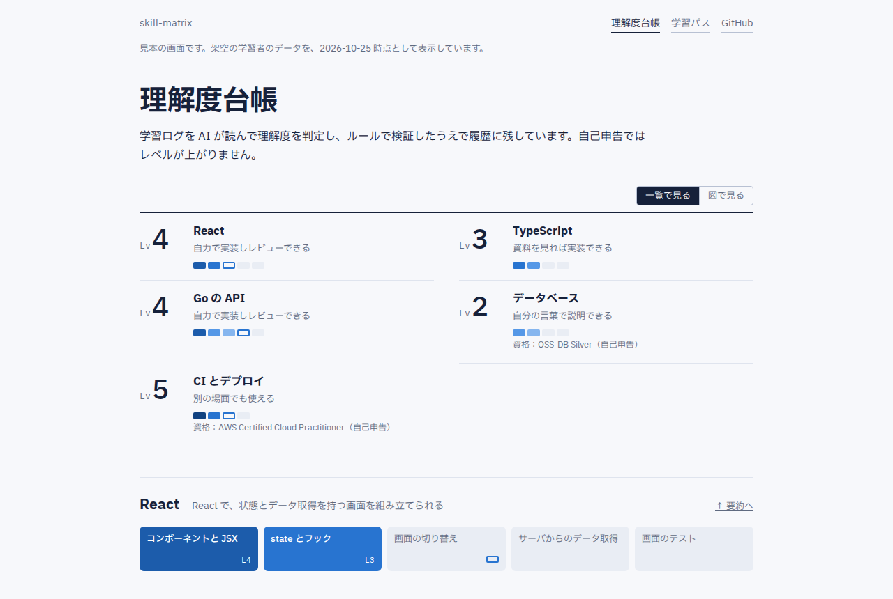
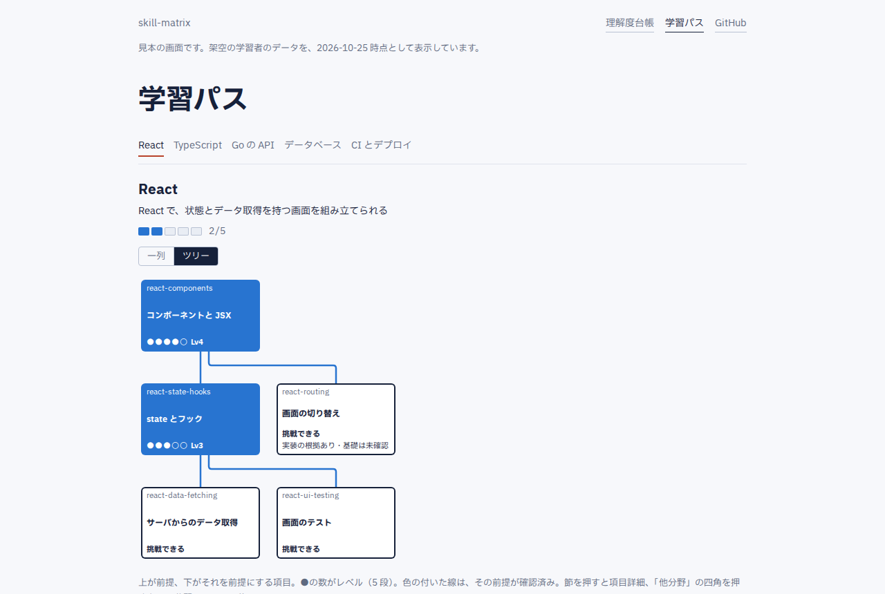
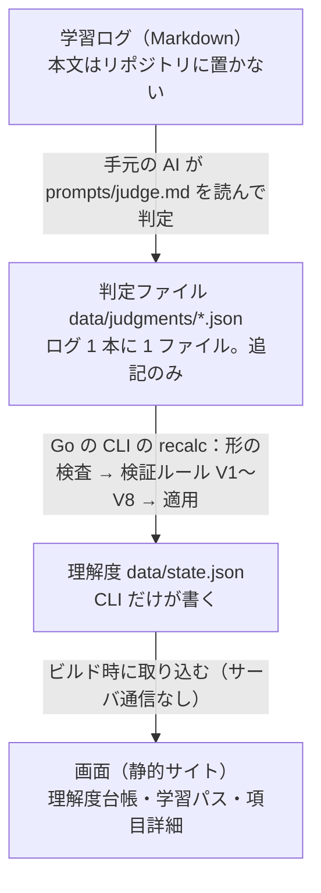

# skill-matrix

学習ログを AI に読ませて理解度を判定させ、ロードマップの「分野 × 項目」の理解度と学習パスを静的サイトで見る、作者が自分用に作ったツール。

チェックボックスを自分で付けるのではなく「今日やったこと・自分の言葉で説明できたこと」を学習ログに書き、AI が根拠付きで判定する。
判定はルールで機械的に検査してから履歴に残すので、自己申告だけでは理解度は上がらない。

| 画面 | URL |
|---|---|
| 作者の実物 | https://n-yoshida-dev.github.io/skill-matrix/ |
| 見本（架空の学習者のデータ） | https://n-yoshida-dev.github.io/skill-matrix/demo/ |

下の 2 枚は見本の画面。





## 仕組み



- 理解度は 0〜5 の段。判定は段に「印」を付け、1 から途切れずに印がある最上段をレベルとする。実装の根拠（3）は基礎の理解（1・2）を含まない
- 判定の基準は `data/roadmap.json` の `levels` に、根拠の種類ごとに付けられる段は `backend/internal/domain/types.go` に、それぞれ 1 か所にだけ書いてある
- サーバ・DB・ログインは無い。データはリポジトリの JSON で、CI の `verify` が `state.json` と再計算の結果が一致するかを確かめる

詳しくは [docs/spec-guide.md](docs/spec-guide.md)（仕様の解説）と [SPEC.md](SPEC.md)（仕様の正本）。

## 自分用に作るには

**手元の AI（Claude Code・Codex CLI など、ファイルを読み書きしてコマンドを実行できるエージェント）を使う前提です。** AI なしで使う手順は用意していません。

このリポジトリはそのまま使う形（Template など）では配っていません。AI 向けの説明書 [docs/build-your-own.md](docs/build-your-own.md) を自分の AI に読ませ、自分のフォルダに必要な部品を写して作らせます。
空のフォルダで、まず見本のデータの画面が出るところまで進み、そこから自分のロードマップと学習ログに切り替えます。

自分の AI に渡す頼み方の例です。

```
https://github.com/n-yoshida-dev/skill-matrix の docs/build-your-own.md を読んで、
このフォルダに自分用の skill-matrix を作ってください。
まず見本のデータで画面が出るところまで進めて、画面の URL を教えてください。
```

約束は「参考にどうぞ」です。使う人の環境で動くことの保証や、作者側の更新の取り込みはありません。

## 必要なもの

- Node.js 24（画面）
- Go（`backend/go.mod` の `go` の行のバージョン以上。判定の検査と `state.json` の再計算をする CLI）
- 判定させる AI（上のとおり）

## 開発

どれもリポジトリ直下で 1 行ずつ打つ（括弧の中だけ `frontend/` に移る）。

```bash
# 画面を開く（http://localhost:5173/#/ が理解度台帳、#/plan が学習パス）
(cd frontend && npm ci && npm run dev)
# 画面（CI と同じ検査）
(cd frontend && npm run format:check && npm run lint && npm run typecheck && npm test && npm run build)
# E2E（ビルドした画面で、JSON を差し替えると表示が変わることを確かめる）
(cd frontend && npx playwright install chromium && npm run e2e)

# 判定の検査・再計算の CLI と単体テスト
go -C backend test ./internal/... ./cmd/skillmatrix
go -C backend run ./cmd/skillmatrix recalc --data ../data   # 判定を検査して state.json を書き直す
go -C backend run ./cmd/skillmatrix verify --data ../data   # CI と同じ（書き出さない）
```

`main` に入ると `.github/workflows/pages.yml` が作者の画面と見本の画面をビルドし、GitHub Pages に上げる。
`backend/` のサーバ・DB・非同期判定のコードは、他人にも使わせるバージョンのために棚上げしてある（`SPEC.md` §10）。今は使わない。

## ドキュメント

- 自分用に作るには（AI 向け）：[docs/build-your-own.md](docs/build-your-own.md)
- 仕様の解説（人間向け）：[docs/spec-guide.md](docs/spec-guide.md)
- データの置き方：[data/README.md](data/README.md)、見本のデータ：[examples/demo/README.md](examples/demo/README.md)
- 開発ドキュメント（作者の AI 向け）：`PLAN.md`（何を・なぜ）／`SPEC.md`（確定した仕様）／`TODO.md`／`KNOWLEDGE.md`／`HANDOFF.md`

## ライセンス

[MIT](LICENSE)。同梱のロードマップ（`data/roadmap.json`・`examples/demo/data/roadmap.json`）はどちらも作者が書いたもので（`origin: "manual"`）、外部のロードマップからの引き写しは含まない。
自分のロードマップを roadmap.sh などから起こすときは、その出典の利用条件に従う。
